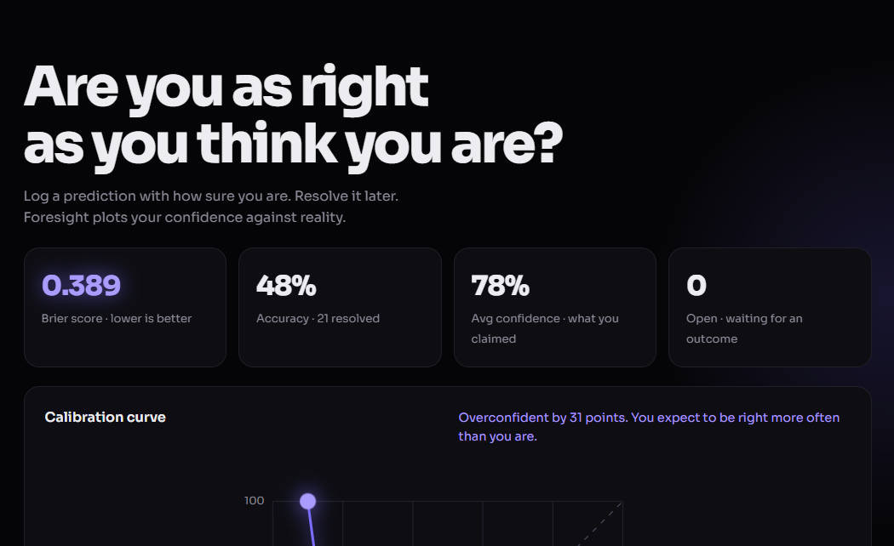
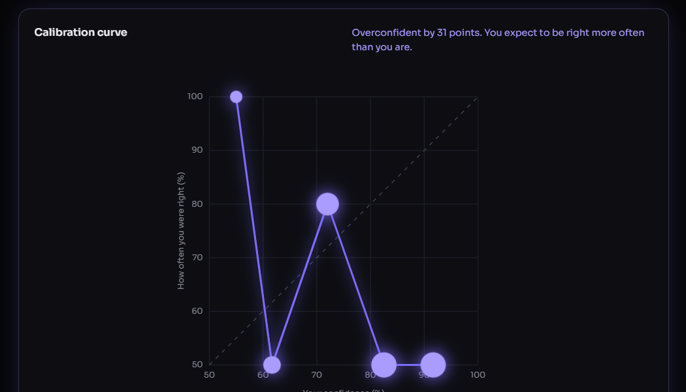
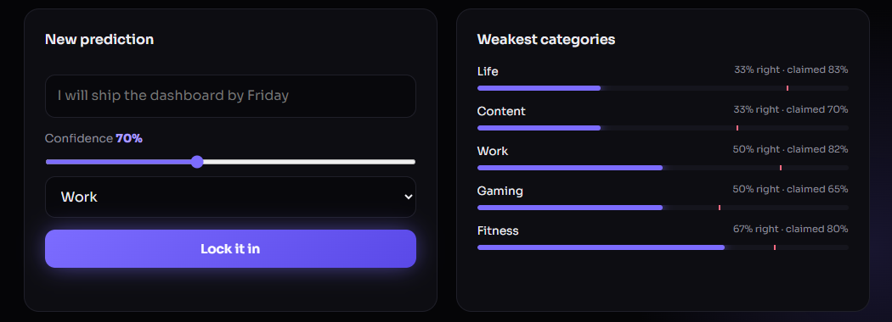
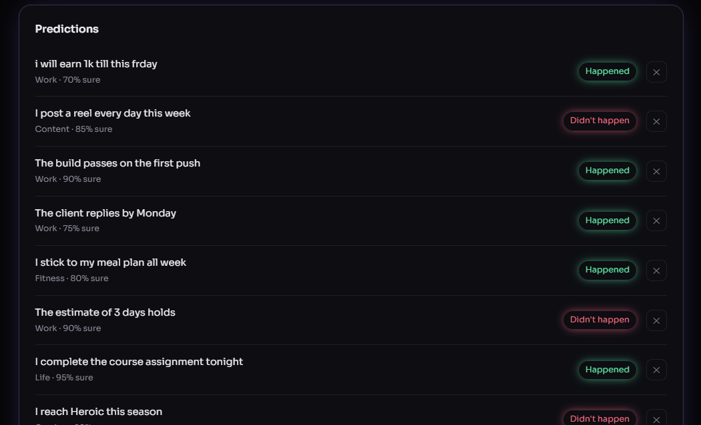

<div align="center">

# Foresight

**Are you as right as you think you are?**

A calibration lab for your predictions. Log what you expect, resolve it later, and see whether your confidence matches reality.

[](https://foresight-7xqp.onrender.com)




</div>

---

## The problem

People are confident far more often than they are correct. "I'll ship this by Friday" feels like a 90% bet, but when you track the outcome it often turns out closer to 40%. Nobody measures that gap, so nobody corrects it.

Foresight measures it. You make a prediction, state how sure you are, and mark what happened. The app turns those results into a score, a chart and a plain-language verdict.

## Features

- **Prediction log** with a confidence slider from 50% to 99% and five categories (Work, Fitness, Gaming, Content, Life)
- **Calibration curve**: your stated confidence plotted against how often you were actually right, compared with the perfect diagonal
- **Brier score**: the standard accuracy metric for probability forecasts (lower is better)
- **Overconfidence verdict**: tells you if you are overconfident, underconfident or well calibrated, and by how many points
- **Category breakdown**: shows where your confidence and results diverge most
- **Demo data loader** to explore a populated dashboard on first run
- **Premium UI**: dark theme, cursor-following glow, self-drawing chart, animated counters, responsive layout, reduced-motion support

## Screenshots

| Calibration curve | New prediction and categories |
|---|---|
|  |  |



## How scoring works

Each resolved prediction has a confidence `p` (for example 0.8) and an outcome `o` (1 if it happened, 0 if not).

```
Brier score = average of (p − o)²
Gap         = average confidence − accuracy
```

- A Brier score of **0** is perfect. Always saying 50% scores **0.25**.
- A positive gap means overconfident. A negative gap means underconfident. Within 5 points counts as well calibrated.
- Predictions are grouped into confidence buckets (50s, 60s, 70s, 80s, 90s). Each bucket becomes one point on the calibration curve, sized by how many predictions it holds.

## Tech stack

| Layer | Technology |
|---|---|
| Backend | Node.js (built-in `http` module), REST API, zero dependencies |
| Persistence | JSON file store (`data/db.json`) |
| Frontend | Vanilla JavaScript (ES6), SVG charts, CSS animations |
| Hosting | Render |

## Getting started

Requires Node.js 18 or newer.

```bash
git clone https://github.com/manashwebdev/foresight.git
cd foresight
npm start
```

Open `http://localhost:4000`. Click **Load demo data** to see a full chart immediately.

Environment variables (optional):

| Variable | Default | Purpose |
|---|---|---|
| `PORT` | `4000` | Server port |
| `DB_FILE` | `data/db.json` | Path of the data file |

## API reference

| Method | Endpoint | Description |
|---|---|---|
| `GET` | `/api/predictions` | List all predictions, newest first |
| `POST` | `/api/predictions` | Create one: `{ text, confidence, category }` |
| `POST` | `/api/predictions/:id/resolve` | Resolve one: `{ outcome: true \| false }` |
| `DELETE` | `/api/predictions/:id` | Delete a prediction |
| `GET` | `/api/stats` | Brier score, accuracy, calibration buckets, category gaps, verdict |
| `POST` | `/api/seed` | Load demo data (only when the store is empty) |

Example:

```bash
curl -X POST http://localhost:4000/api/predictions \
  -H "Content-Type: application/json" \
  -d '{"text":"I will ship the dashboard by Friday","confidence":85,"category":"Work"}'
```

## Project structure

```
foresight/
├── server/
│   ├── server.js     # HTTP server, routing, static files
│   ├── stats.js      # Brier score, buckets, verdict (pure functions)
│   └── store.js      # JSON persistence and demo seed
├── public/
│   ├── index.html
│   ├── styles.css    # Glow, motion and layout
│   └── app.js        # State, rendering, SVG chart
├── docs/screenshots/
└── package.json
```

## Deployment

1. Push the repository to GitHub.
2. Create a **Web Service** on [Render](https://render.com) and connect the repo.
3. Leave the build command empty and set the start command to `npm start`.

The free tier spins down when idle, so the first request after a pause can take about 30 seconds. Render's free filesystem is also temporary, so saved predictions reset on redeploy. For permanent storage, swap `server/store.js` for a database such as MongoDB.

## Roadmap

- [ ] MongoDB storage for persistent data
- [ ] User accounts so each person keeps a private log
- [ ] Due dates with reminders to resolve predictions
- [ ] Export results as CSV
- [ ] Trend chart of Brier score over time

## Author

Built by **Manash Khati** ([@manashwebdev](https://github.com/manashwebdev)).

## License

MIT
